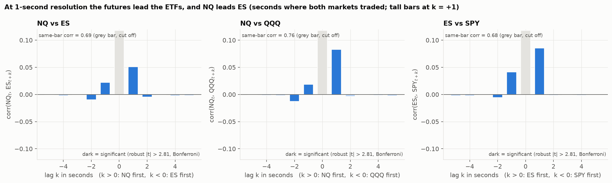
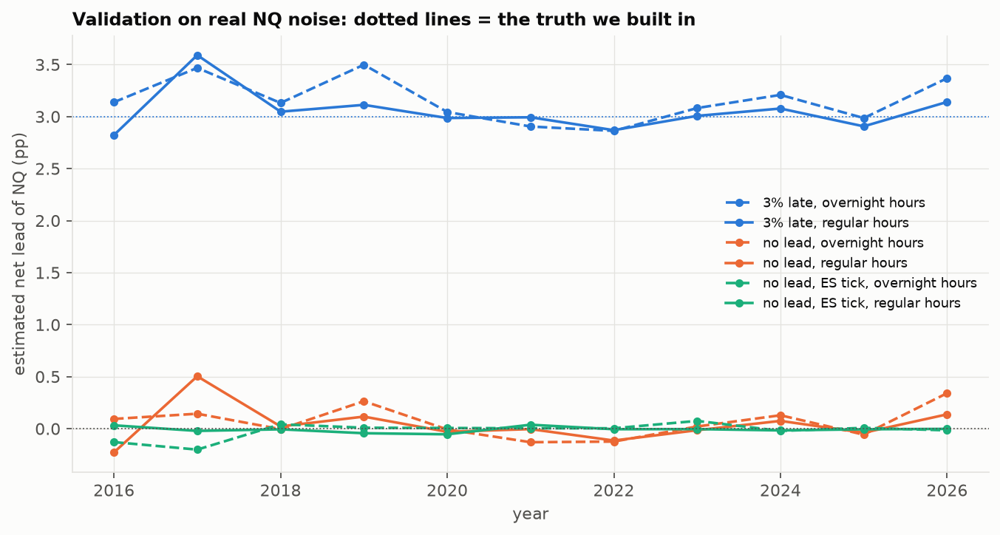
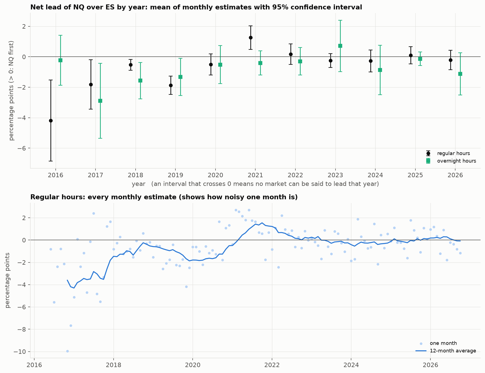
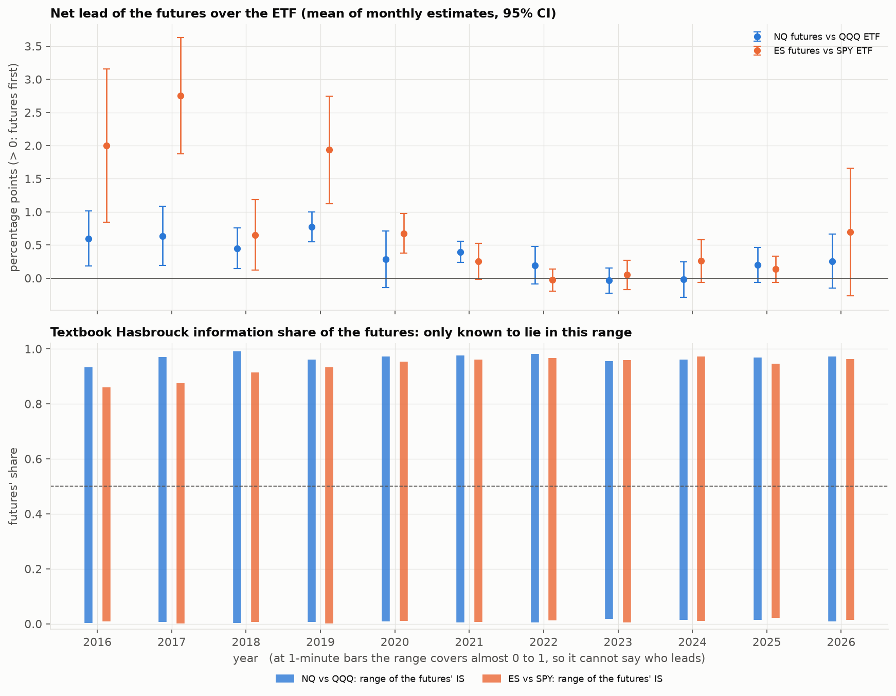
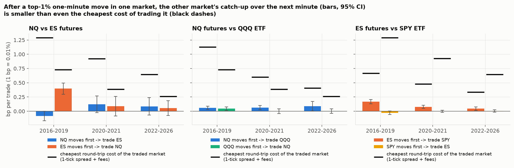
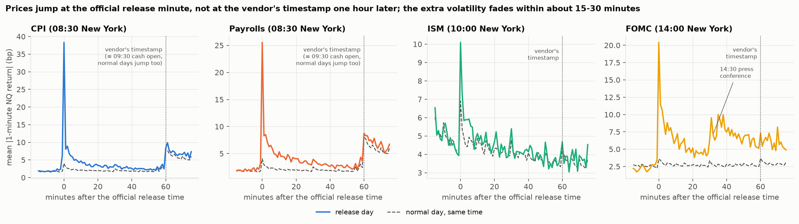
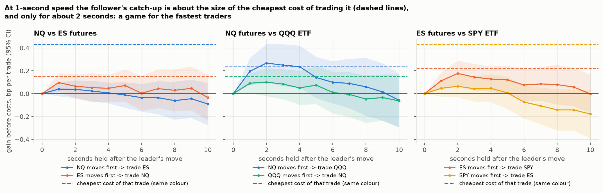

# Who Moves First? Information Diffusion between Nasdaq-100 and S&P 500 Markets

[](https://github.com/unaifmm/information-diffusion-nasdaq-sp500/actions/workflows/tests.yml)

[](LICENSE)

**How fast does new information spread between the two largest US equity-index markets, and where is it priced first?**

When news hits the market (a CPI print, an FOMC decision, NVIDIA earnings, a large order), it does not reach every price at the same instant. This project measures that *diffusion* of information for the E-mini futures (NQ, ES) and the ETFs (QQQ, SPY) that track the Nasdaq-100 and the S&P 500. It uses ten years of 1-minute data (2016-2026), 1-second data for July-October 2026 and 453 macro announcements.

*Unai Fueyo Montalvo · BSc Economics, Universidad Autónoma de Madrid · [LinkedIn](https://www.linkedin.com/in/unai-fueyo-montalvo-63823339b)*

**Read the paper:** [full paper (PDF, 12 pages)](docs/Who_Moves_First_paper.pdf) · [one-page summary (PDF)](docs/Who_Moves_First_summary.pdf)

## Key findings

1. **Standard tests can invent a lead.** A coarser tick size alone made Granger tests report a lead in 11 of 11 years of data built with no lead. The "net lead" measure used here was validated instead: it recovers a planted 3.0 pp lead at 3.05-3.15 pp.
2. **The S&P futures used to move first; at 1-minute resolution, today neither does.** ES led NQ by 1.86 pp in 2016-2019 (95% CI [1.14, 2.58]). Since 2022 the net lead is -0.10 pp [-0.38, 0.17], not distinguishable from zero. The change tracks liquidity: NQ's share of NQ+ES dollar volume rose from about 10% to 35% (t = 4.8).
3. **News reaches all four markets in the same minute.** The minute of a CPI release is 9.5x as volatile as normal, and prices follow the surprise (-32 bp per standard deviation of CPI surprise). No market leads in the 20 minutes after releases.
4. **At 1-second resolution the leads are clear.** NQ leads QQQ and ES leads SPY on 100% of days, and NQ leads ES on 91%. These leads only became measurable once a "staleness trap" was handled: a market that trades in fewer seconds looks like a follower even with no real delay.
5. **None of it can be traded at human speed.** At 1-minute speed the catch-up is at most 55% of the cheapest trading cost. At 1-second speed it roughly equals the cost (0.27 bp vs 0.24 bp for QQQ) and is gone after about 2 seconds: the lead survives exactly up to the cost of exploiting it.



---

## Research questions

1. **Lead-lag (NQ vs ES).** Does one index future move first and the other follow? How large is the delay, how has it changed from 2016 to 2026, and does it differ by hour of the day and between the regular and overnight sessions?
2. **Price discovery (futures vs ETFs).** For each index, is new information priced first in the futures or in the ETF? This is a modern replication of Hasbrouck (2003).
3. **News.** How does diffusion change in the minutes around scheduled macro announcements (CPI, payrolls, FOMC)?
4. **Economic significance.** Is any measured lead large enough to matter after trading costs, and for whom?

## Pipeline

| Step | Script |
|---|---|
| 1. Data download (London Strategic Edge: 1-minute 2016-2026, 1-second 2026, economic calendar) | `01_download_data.py` |
| 2. Validation I: simulated markets with a known answer | `02_validate_simulation.py` |
| 3. Validation II: real NQ noise, including tick-size effects | `03_validate_real_noise.py` |
| 4. Market anatomy: daily picture, intraday profile, liquidity, tick size | `04_market_anatomy.py` |
| 5. NQ vs ES: by year, hour and bar size | `05_nq_vs_es.py` |
| 6. NQ vs ES: confidence intervals (monthly estimates) and the liquidity hypothesis | `06_nq_es_robustness.py` |
| 7. Futures vs ETF price discovery (NQ vs QQQ, ES vs SPY) | `07_futures_vs_etf.py` |
| 8. Event study around macro announcements (CPI, payrolls, ISM, FOMC) | `08_event_study.py` |
| 9. 1-second lead-lag, including the staleness trap and its fix | `09_one_second.py` |
| 10. Economic significance: can the lead be traded after costs? (1-minute and 1-second) | `10_economic_significance.py` |
| All of the above, plus 31 unit tests, with one command | `run_all.py`, `tests/` |

## Methods

All returns are 1-minute log returns, $r_t = \ln(P_t / P_{t-1})$. Returns spanning a gap (overnight, weekend, the futures' daily maintenance break, a missing bar) are discarded.

**Cross-correlation function.** $\rho(k) = \mathrm{corr}(x_t, y_{t+k})$. Significance uses the robust t-statistic of Dalla, Giraitis & Phillips (2022), which is valid under volatility clustering, with a Bonferroni correction across lags.

**Granger causality.** $y_t = c + \sum_{i=1}^{p} a_i y_{t-i} + \sum_{i=1}^{p} b_i x_{t-i} + \varepsilon_t$, testing $H_0: b_1 = \dots = b_p = 0$ with HAC standard errors. Lag length is chosen by BIC, and lags are taken on the clock (t − 1 minute), never across session gaps.

**Diffusion curve.** A bivariate VAR is estimated by OLS and its *generalized* impulse responses (Pesaran & Shin, 1998) are computed. These are invariant to variable ordering, which matters when same-minute correlation is about 0.9. The diffusion curve is the share of the long-run response of $y$ to a shock in $x$ that has arrived $h$ bars after the shock:

$$\text{share}(h) = \frac{\sum_{s=0}^{h} \mathrm{GIRF}_{y \leftarrow x}(s)}{\sum_{s=0}^{H} \mathrm{GIRF}_{y \leftarrow x}(s)}$$

**Net lead.** Microstructure noise (bid-ask bounce) makes the first bar over-shoot in *both* directions. The net lead takes the difference, so the common noise cancels:

$$\text{net lead}_{NQ} = [1-\text{share}_{ES \leftarrow NQ}(0)] - [1-\text{share}_{NQ \leftarrow ES}(0)]$$

A positive value (in percentage points) means NQ moves first.

**Precision.** The net lead is estimated separately for every calendar month and session (≈125 months × 2). A period's estimate is the mean of its monthly estimates, with a 95% confidence interval of mean ± 1.96·sd/√(months). This is the same logic as Fama-MacBeth standard errors.

**Price discovery between futures and ETFs (VECM).** For pairs that track the same index, a vector error-correction model on log prices is estimated each month. The error-correction term is the futures-ETF log gap, demeaned by day to remove the basis and dividends. From it come the Hasbrouck (1995) information share (both Cholesky orderings, giving bounds), the Gonzalo-Granger (1995) component share and the Putniņš (2013) information leadership share. These are reported for comparison with the literature; conclusions are drawn from the validated net lead.

**Liquidity hypothesis.** Monthly net leads are regressed on NQ's share of NQ+ES dollar volume, with and without a linear time trend, using HAC (Newey-West, 6 lags) standard errors.

**Economic significance.** The trade a lead-lag arbitrageur would make: when the leader $L$ makes one of its top-1% one-minute moves (within each month), buy the follower $F$ in the same direction and hedge with $\beta$ units of the leader, then close after $h$ minutes. The hedge removes market-wide moves, leaving only the follower's catch-up:

$$\text{catch-up}(h) = \operatorname{sign}(r_{L,t})\,\big[(p_{F,t+h}-p_{F,t}) - \beta\,(p_{L,t+h}-p_{L,t})\big], \qquad \beta = \frac{\operatorname{cov}(r_F, r_L)}{\operatorname{var}(r_L)}$$

At 1-minute bars it is compared with the *cheapest* cost of the trade: one round trip in the follower at a one-tick spread plus fees (about $2 per futures contract and $0.0035 per ETF share per side), with no market impact. The costs are deliberately optimistic, so a lead that does not beat them cannot be traded at that speed. Monthly averages are combined into period means with 95% CIs, as above. Top-10% and top-0.1% moves are used as robustness checks. At 1-second bars the same trade is held for 1-10 seconds after the leader's top-0.1% seconds. The gain is the follower's own move, because over longer holds the hedge books the leader's reversal after its biggest seconds as profit. Daily estimates are combined with 95% CIs.

**Macro announcements.** CPI, payrolls (08:30 New York), ISM Manufacturing (10:00) and FOMC decisions (14:00), 2016-2026, from the London Strategic Edge economic calendar. **The vendor's timestamps are one hour late** for about 90% of the history (back-filled entries), while live 2026 entries are right. So event *dates* come from the calendar and *times* from the official schedule. This is verified with prices: the biggest NQ minute within ±90 minutes falls on the official minute for 47% of CPI releases, against 5% on the vendor's minute. Diffusion in the 20 minutes after each release is compared with the same clock time on the 10 nearest normal days, with 95% CIs from a bootstrap over releases.

**1-second bars and the staleness trap.** 1-second data (regular hours, July-October 2026) is put on a common clock by previous-tick sampling. A market that did not trade in a second keeps its old price, so its move appears a second later. This creates a **fake lead** (non-synchronous trading; Epps, 1979). A placebo shows how large it is: a copy of NQ that merely trades in fewer seconds "lags" NQ by +7 pp of net lead. Lead-lag at 1 second is therefore measured only on seconds in which **both** markets traded, which removes the fake lead in the placebo (−0.0001, CI includes 0). The measure is the lag-1 asymmetry corr(a<sub>t</sub>, b<sub>t+1</sub>) − corr(b<sub>t</sub>, a<sub>t+1</sub>), estimated per day.

## Validation: why the net lead, and not Granger

Before touching the real NQ-ES data, the measures were tested where the answer is known.

1. **Simulated markets** (`02_validate_simulation.py`). With 80% of the news reaching the follower in the same minute, the estimated share was **80.3%**. With instant diffusion, no lead-lag was found. In part 2 (same-asset pairs with different noise levels), the net lead had the right sign and size in all six cases, while the textbook VECM measures did not (see Results, point 4).
2. **Real NQ noise** (`03_validate_real_noise.py`). Ten years of real 1-minute NQ returns were used to build artificial followers with a known truth:

| Scenario (11 years, regular / overnight hours) | Net lead found | Granger says "NQ leads" (p < 0.01) |
|---|---|---|
| Follower absorbs 3% of each move one minute late (truth: +3.0 pp) | **3.05 / 3.15 pp** | 4/11 years |
| No lead (truth: 0) | **0.04 / 0.06 pp** | 0/11 and 3/11 years |
| **No lead, but the follower trades on ES's coarser 0.25-point price grid** (truth: 0) | **−0.01 / −0.02 pp** | **11/11 years: false alarm** |

**A coarser tick alone makes Granger tests report a lead that does not exist.** ES's tick is 2-4× coarser than NQ's relative to price (see `04_liquidity_and_tick.png`), so Granger p-values on NQ vs ES are contaminated. Conclusions are drawn from the net lead.



## Results

**1. NQ vs ES: the S&P futures used to move first; today neither does.** Net lead of NQ over ES, as the mean of monthly estimates with a 95% CI:

| Period | Regular hours | Overnight |
|---|---|---|
| 2016-2019 | **−1.86 pp** [−2.58, −1.14] | −1.65 [−2.54, −0.76] |
| 2020-2021 | +0.37 [−0.25, 0.99] | −0.46 [−1.19, 0.26] |
| 2022-2026 | **−0.10** [−0.38, 0.17] | −0.32 [−0.90, 0.26] |

**2. Liquidity explains it.** Regressing the monthly net lead (regular hours, 125 months) on NQ's share of NQ+ES dollar volume gives a slope of **+12.9** (t = 4.8, R² = 0.27). That is +1.3 pp of net lead per 10-point gain in NQ's volume share. It stays significant with a time-trend control (t = 3.9). NQ's share rose from ≈10% in 2016 to ≈35% in 2026, and ES's lead faded as it did.

**3. Futures lead ETFs, but the lead has almost vanished at 1-minute resolution.** Net lead of the futures over the ETF, regular hours:

| Period | NQ vs QQQ | ES vs SPY |
|---|---|---|
| 2016-2019 | **+0.62 pp** [0.44, 0.79] | **+1.82 pp** [1.35, 2.28] |
| 2020-2021 | +0.34 [0.12, 0.56] | +0.46 [0.25, 0.68] |
| 2022-2026 | +0.10 [−0.02, 0.23] | +0.21 [0.01, 0.40] |

**4. Textbook price-discovery measures do not work at 1-minute bars.** On simulated pairs with a known answer (`02_validate_simulation.py`, part 2), Hasbrouck's information share could only be bounded between about 0 and 1. The Gonzalo-Granger component share and Putniņš' leadership share pointed the wrong way in several cases. On the real data, the information-share bounds are about [0.01, 0.96] every year, and the component share falls outside [0, 1] in most months. The net lead recovered the truth in all six simulated cases.

**5. None of these leads can be traded at one-minute speed.** After the leader's top-1% one-minute moves, the follower's hedged catch-up over the next minute (mean of monthly estimates, 95% CI) is compared with the cheapest cost of trading it:

| Trade | Period | Catch-up (bp) | Cheapest cost (bp) | Catch-up as % of cost |
|---|---|---|---|---|
| ES moves → trade NQ | 2016-2019 | **0.40** [0.30, 0.49] | 0.73 | 55% |
| | 2022-2026 | 0.05 [−0.08, 0.18] | 0.26 | 19% |
| NQ moves → trade QQQ | 2016-2019 | 0.06 [0.03, 0.09] | 1.13 | 5% |
| | 2022-2026 | 0.09 [0.01, 0.17] | 0.41 | 22% |
| ES moves → trade SPY | 2016-2019 | 0.17 [0.13, 0.21] | 0.66 | 25% |
| | 2022-2026 | 0.05 [0.01, 0.08] | 0.34 | 13% |

The leads in points 1 and 3 are statistically real (t up to 8.9) but economically too small. Almost all of the follower's reaction happens in the *same* minute as the leader's move: after a 12.5 bp ES move in 2016-2019, NQ had already moved 14.4 bp. Only a fraction of a basis point is left to catch, less than the minimum cost of a trade. The unhedged version of the trade (follower only) is not significantly profitable in any period either. This is what Grossman & Stiglitz (1980) predict: a lead can survive only while it is smaller than the cost of trading on it.

**6. News is priced by everyone in the same minute.** The vendor's calendar times were an hour late and had to be corrected (see Methods). The minute of a CPI release is **9.5×** as volatile as the same minute on a normal day; payrolls 6.3×, FOMC 5.7×. The extra volatility fades within 15-30 minutes, and FOMC days show a second burst at the 14:30 press conference. Prices follow the surprise: each standard deviation of CPI surprise moves ES by **−32 bp** in 5 minutes (t = −4.1). After CPI, payroll and FOMC releases, NQ and ES move more tightly together (same-minute correlation 0.95-0.97, against 0.91-0.93 at the same time on normal days). Neither leads: every 95% CI of the net lead includes zero. The futures-over-ETF lead also disappears around news (+0.09 [−0.55, 0.62] for NQ vs QQQ). Public, scheduled news reaches all four markets at once. The leads in points 1 and 3 come from the rest of the day's information flow.

**7. At 1-second resolution the leads are clear: the futures lead the ETFs, and NQ leads ES.** Lag-1 asymmetry on seconds where both markets traded, mean of 73-75 daily estimates (July-October 2026):

| Pair | corr(a now, b 1 s later) | corr(b now, a 1 s later) | Asymmetry [95% CI] | Days with a first |
|---|---|---|---|---|
| NQ vs QQQ | 0.095 | 0.017 | **+0.077** [0.071, 0.084] | 100% |
| ES vs SPY | 0.087 | 0.044 | **+0.042** [0.038, 0.047] | 100% |
| NQ vs ES | 0.056 | 0.022 | **+0.035** [0.030, 0.039] | 91% |

These are 10-25× larger than what is left of the fake lead in the placebo. At 1-minute bars they were invisible (point 1: NQ vs ES −0.10 pp since 2022), because almost the whole reaction happens in the same second and the rest within 1-2 seconds. The NQ-over-ES lead is consistent with point 2: NQ is now the more actively traded of the two, trading in 89% of seconds against ES's 83%. Caveat: 1-second bars cannot separate a lead of a few hundred milliseconds from one market's last trade simply landing later within the second. Millisecond tick data would.

**8. At 1-second speed the lead is worth about the cost of trading it, for about 2 seconds.** After the futures' top-0.1% seconds, the ETF's catch-up peaks after 2 seconds:

| Trade (follower only) | Best gain before costs (95% CI) | Cheapest cost | Gain if you are 1 s late |
|---|---|---|---|
| NQ moves → trade QQQ | 0.27 bp [0.10, 0.43], at 2 s | 0.24 bp | 0.07 bp |
| ES moves → trade SPY | 0.18 bp [0.06, 0.29], at 2 s | 0.22 bp | 0.06 bp |
| ES moves → trade NQ | 0.10 bp [0.01, 0.18], at 1 s | 0.15 bp | ≈ 0 |

These numbers assume trading instantly at the last traded price, at a one-tick spread, with no market impact. In practice the gain is smaller still. A one-minute trader gets nothing (point 5). A trader reacting within a second roughly breaks even. Whatever profit exists belongs to firms that react in milliseconds, which is the "arms race" Budish, Cramton & Shim (2015) describe for ES and SPY. The lead survives exactly up to the cost of exploiting it.








## Limitations and next steps

- **Sub-second timing.** 1-second bars cannot separate a lead of a few hundred milliseconds from one market's last trade simply landing later within the second. Millisecond tick data (available from the same vendor) would time the lead exactly.
- **Short 1-second sample.** The 1-second results cover 73-75 trading days (July-October 2026). They are very consistent day to day, but a longer sample would show whether they change over time.
- **Trade prices, not quotes.** Bars are built from last-trade prices, so gains are measured at prices that may not have been executable. Costs assume a one-tick spread and no market impact. Both choices favour the trader, so the "not tradeable" conclusion is conservative.
- **One vendor.** All data comes from London Strategic Edge. Its quality was cross-checked (futures vs ETFs, known closes, news timing), and two vendor issues were found and handled (see Data).

## Data

| Source | Instruments | Frequency | Period |
|---|---|---|---|
| [London Strategic Edge](https://londonstrategicedge.com) via `lse-data` | NQ.F, ES.F (CME E-mini futures), QQQ, SPY | 1-minute OHLCV | May 2016 → Oct 2026 |
| London Strategic Edge | same four, regular hours only | 1-second OHLCV | Jul 2026 → Oct 2026 (73-75 days) |
| London Strategic Edge | US economic calendar (CPI, payrolls, ISM, FOMC, ...) | release dates, actual vs consensus | May 2016 → Oct 2026 |

- About 3.6M 1-minute bars per future and about 1M per ETF. NQ and ES share 3.6M common minutes.
- **Quality checks** (`04_market_anatomy.py`): futures and ETFs on the same index agree at the daily close (daily return correlation 0.996, median gap about 1 bp). ETF prices match known historical closes. The largest 1-minute moves are scheduled news (CPI releases at 08:30, the March 2020 emergency Fed cut, the April 2025 tariff pause), not data errors.
- **Vendor issues found and handled:** calendar times one hour late for back-filled history (corrected to the official schedule and verified with prices). Futures data on 12 Oct 2026 starts only at 14:43, in both 1-minute and 1-second bars (kept; it only shortens that day).
- One source for all instruments means consistent timestamps and cleaning. An earlier version used free Yahoo Finance data and was dropped after checks found bad prints, where index and ETF disagreed by more than 1% on 131 days in 2000-2003.
- Raw data is not committed to this repository (vendor terms). `01_download_data.py` downloads it with an LSE API key.

## How to run

Windows PowerShell, from the project folder:

```
py -m venv .venv
.venv\Scripts\activate
pip install -r requirements.txt
python run_all.py --download
```

`run_all.py --download` updates the data, runs the unit tests and then every analysis script in order, stopping at the first error. Without `--download` it re-runs the analysis on the data already on disk. `--from 05` starts at a given script. Each script can also be run on its own (`python 05_nq_vs_es.py`) and writes its figures to `figures/` and its tables to `results/`, prefixed with the script number.

The download needs a London Strategic Edge API key saved with `lse auth <key>`. The unit tests (`python -m pytest`, about 10 seconds) need no data and no key. They check the building blocks against cases with a known answer, including a fake data vendor for the downloader.

## Project structure

```
├── 01_download_data.py         download 1-minute, 1-second and calendar data (London Strategic Edge)
├── 02_validate_simulation.py   validation I: simulated markets with a known lead
├── 03_validate_real_noise.py   validation II: real NQ noise, incl. tick-size effects
├── 04_market_anatomy.py        daily picture, intraday profile, liquidity, tick size
├── 05_nq_vs_es.py              NQ vs ES diffusion by year, hour and bar size
├── 06_nq_es_robustness.py      monthly estimates, confidence intervals, liquidity regression
├── 07_futures_vs_etf.py        futures vs ETF price discovery (net lead + VECM measures)
├── 08_event_study.py           CPI, payrolls, ISM, FOMC: timing check, reactions, surprises, diffusion
├── 09_one_second.py            1-second lead-lag, the staleness trap and its fix
├── 10_economic_significance.py can the lead be traded after costs? (1-minute and 1-second)
├── run_all.py                  one command: tests + every script in order
├── LICENSE                     MIT
├── CITATION.cff                how to cite this project (GitHub's "Cite this repository" button)
├── .github/workflows/tests.yml runs the unit tests on GitHub at every change
├── src/
│   ├── config.py               instruments, contract specs, folders
│   ├── lse.py                  London Strategic Edge download and loading
│   ├── data.py                 session masks, returns, daily closes, previous-tick 1-second grid
│   ├── events.py               macro releases: official times, surprises, event windows
│   ├── leadlag.py              cross-correlation, Granger, VAR, diffusion curves, net lead
│   ├── pricediscovery.py       VECM: Hasbrouck IS, Gonzalo-Granger CS, Putniņš ILS
│   ├── economics.py            trading costs and the hedged catch-up trade
│   ├── simulate.py             toy market with a known lead-lag
│   └── plots.py                shared chart style
├── tests/                      unit tests (pytest), no data needed
├── docs/                       the paper, its one-page summary and the social preview image
├── figures/                    output charts
└── results/                    output tables (CSV)
```

## License

Code: MIT (see `LICENSE`). Data is not included and belongs to London Strategic Edge.

## References

- Andersen, T. G., Bollerslev, T., Diebold, F. X. & Vega, C. (2003). Micro effects of macro announcements: Real-time price discovery in foreign exchange. *American Economic Review*, 93(1), 38-62.
- Budish, E., Cramton, P. & Shim, J. (2015). The high-frequency trading arms race: Frequent batch auctions as a market design response. *Quarterly Journal of Economics*, 130(4), 1547-1621.
- Dalla, V., Giraitis, L. & Phillips, P. C. B. (2022). Robust tests for white noise and cross-correlation. *Econometric Theory*, 38(5), 913-941.
- Epps, T. W. (1979). Comovements in stock prices in the very short run. *Journal of the American Statistical Association*, 74(366), 291-298.
- Gonzalo, J. & Granger, C. (1995). Estimation of common long-memory components in cointegrated systems. *Journal of Business & Economic Statistics*, 13(1), 27-35.
- Granger, C. W. J. (1969). Investigating causal relations by econometric models and cross-spectral methods. *Econometrica*, 37(3), 424-438.
- Grossman, S. J. & Stiglitz, J. E. (1980). On the impossibility of informationally efficient markets. *American Economic Review*, 70(3), 393-408.
- Hasbrouck, J. (1995). One security, many markets: Determining the contributions to price discovery. *Journal of Finance*, 50(4), 1175-1199.
- Hasbrouck, J. (2003). Intraday price formation in U.S. equity index markets. *Journal of Finance*, 58(6), 2375-2399.
- Hong, H. & Stein, J. C. (1999). A unified theory of underreaction, momentum trading, and overreaction in asset markets. *Journal of Finance*, 54(6), 2143-2184.
- Pesaran, H. H. & Shin, Y. (1998). Generalized impulse response analysis in linear multivariate models. *Economics Letters*, 58(1), 17-29.
- Putniņš, T. J. (2013). What do price discovery metrics really measure? *Journal of Empirical Finance*, 23, 68-83.

*For research and educational purposes only. Not investment advice.*
